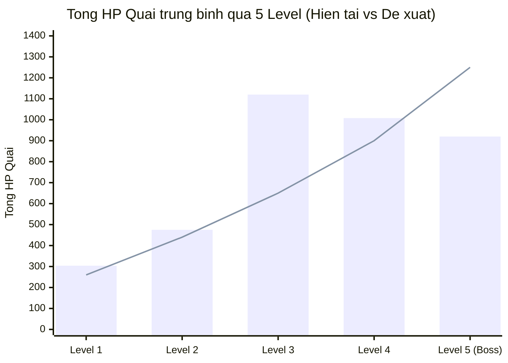
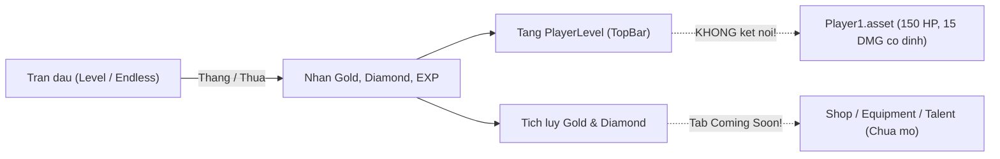
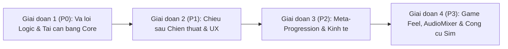

# Đánh Giá Cân Bằng Game & Kế Hoạch Cải Tiến — Hero's Adventure

**Môi trường dự án:** Unity `2022.3.62f3` · Built-in Render Pipeline (2D Sprite + uGUI + DOTween)  
**Tài liệu kỹ năng Unity đối chiếu:** `using-unity` → `craft-game-floors` (`playable-loop.md`, `game-feel.md`, `vfx.md`, `game-audio.md`, `game-shell.md`, `visual-scorecard.md`) & `build-live-game` (Remote Config / Economy). *(Lưu ý kỹ thuật: Dự án dùng Built-in RP 2D nên bỏ qua các tiêu chí ánh sáng 3D URP, áp dụng bộ tiêu chuẩn 2D Anchor Set & Game Feel).*

---

## Phần 1: Đánh Giá Hiện Trạng Cân Bằng Game (Quantitative Audit)

> [!IMPORTANT]
> Mã nguồn thực tế đã chuyển từ cơ chế **Line-Matching (5 AP/lượt)** trong [README.md](../README.md#L18-L35) sang **Shared-Board Match-3 Swap & Cascade (1 AP/lượt, lưới 8×8, AI dùng chung bàn cờ)** tại [GameGrid.cs](../Assets/Scripts/GameGrid/GameGrid.cs#L9-L16) và [BattleManager.cs](../Assets/Scripts/Manager/BattleManager.cs#L14-L15). Toàn bộ phân tích dưới đây dựa trên dữ liệu thực thi trong `GameScene.unity` và `Resources/SO`.

### 1.1. Công thức Sát thương, Combo & Nổ ngọc lan (Siêu lạm phát đột biến)

Trong [BattleManager.cs](../Assets/Scripts/Manager/BattleManager.cs#L240-L307) và [GameGrid.cs](../Assets/Scripts/GameGrid/GameGrid.cs#L480-L511), sát thương một lượt được tính theo chuỗi nhân kép:

$$\text{RawDamage} = \text{BaseDamage} \times \left(1 + \mathbb{I}_{\text{crit}} \frac{\text{CritDmg}}{100}\right) \times \left(\sum \text{TurnDamage}\right) \times \text{ComboMultiplier}$$

Trong đó $\text{ComboMultiplier} = 1 + (\text{currentTurnMatches} - 1) \times 0.2$. Hệ thống này đang gặp **3 lỗi thiết kế toán học nghiêm trọng**:

1. **Lỗi nhân 3 giá trị và cộng dồn bộ đếm Combo cho từng viên ngọc nổ lan (`extraBlastedGems`):**
   - Một cụm Match-3 tiêu chuẩn (gồm **3 viên** `DamageGem`) chỉ kích hoạt `OnGemsMatched` **1 lần** với `totalPower = 1.0` và `currentTurnMatches += 1` (tức trung bình **0.333 power / viên**).
   - Tuy nhiên tại [GameGrid.cs](../Assets/Scripts/GameGrid/GameGrid.cs#L498-L511), khi Match-4 quét nổ cả hàng/cột (thêm 4 viên ngoài cụm), **mỗi viên lẻ bị nổ** lại bắn một sự kiện `OnGemsMatched` riêng với `MatchCount = 3` (`totalPower = 1.0` — gấp **3 lần** giá trị 1 viên thường) **và tăng `currentTurnMatches` thêm 1 cho mỗi viên lẻ**.
   - **Hệ quả thực tế:** Chỉ cần 1 nước đi Match-4 ngang có 2 viên `DamageGem` trên đường nổ và 2 nhịp cascade nhẹ, `currentTurnMatches` vọt lên `7` ($\text{ComboMultiplier} = 2.2\times$), `turnDamage` đạt `~4.25`, tổng hệ số nhân sát thương vọt lên **$9.35\times$** ($\approx 140\text{–}210$ sát thương). Cả người chơi lẫn quái AI đều có thể **one-shot đối phương chỉ sau 1 lượt swap may mắn**.
2. **Tỉ lệ rơi `DamageGem` quá cao trên bàn 8×8:**
   - Trong [DamageGem.asset](../Assets/Resources/SO/GemInfo/DamageGem.asset#L18-L19), `spawnWeight = 3` trong khi 5 loại ngọc còn lại đều có `spawnWeight = 1` (tổng trọng số = 8). Xác suất rơi `DamageGem` là **$37.5\%$** (`3/8`). Trên bàn 8×8 chỉ cần 3 viên thẳng hàng, mật độ $37.5\%$ gây ra chuỗi cascade tự động dày đặc, làm mất tính kiểm soát chiến thuật và biến trận đấu thành trò quay số RNG.
3. **Nghịch lý Match-4 mạnh hơn Match-5:**
   - Tại [GameGrid.cs](../Assets/Scripts/GameGrid/GameGrid.cs#L596-L644), Match-4 thẳng hàng nổ toàn bộ hàng/cột 8 ô (**+4 viên nổ thêm**). Ngược lại, Match-5 thẳng hàng rơi vào nhánh `TriggerAreaBlast` (nổ vùng $3\times 3$ quanh tâm): nếu nằm ở hàng biên (`y = 0` hoặc `y = 7`), Match-5 chỉ nổ thêm **3 viên** — khó ghép hơn nhưng yếu hơn Match-4.

---

### 1.2. Mất cân bằng giữa 6 loại Ngọc & Lỗi Công thức Giáp (Shield)

| Loại Ngọc | Asset | `powerValue` | `spawnWeight` (% rơi) | Cơ chế hiện tại | Đánh giá Cân bằng |
|---|---|---:|---:|---|---|
| **Damage** | [DamageGem.asset](../Assets/Resources/SO/GemInfo/DamageGem.asset) | `1` (hệ số) | `3` (37.5%) | Nhân với `BaseDamage` và `ComboMultiplier` | Quá áp đảo nhờ tỉ lệ rơi 37.5% và nhân kép |
| **Health** | [HealthGem.asset](../Assets/Resources/SO/GemInfo/HealthGem.asset) | `15` HP | `1` (12.5%) | Hồi thẳng HP $\times$ `ComboMultiplier` | Tốt ở đầu game, đuối dần ở Endless vì trị số tĩnh (`15`) |
| **Shield** | [ShieldGem.asset](../Assets/Resources/SO/GemInfo/ShieldGem.asset) | `15` Giáp | `1` (12.5%) | Giảm sát thương theo % rồi trừ giáp | **Phế nhất game** do lỗi công thức lai (xem dưới) |
| **Crit Rate** | [CritRateGem.asset](../Assets/Resources/SO/GemInfo/CritRateGem.asset) | `+5%` | `1` (12.5%) | Cộng vĩnh viễn cả trận (trần `50%`), không nhân combo | Quá mạnh ở trận dài/Endless, vô dụng sau khi chạm trần 50% |
| **Crit Damage** | [CritDamageGem.asset](../Assets/Resources/SO/GemInfo/CritDamageGem.asset) | `+15%` | `1` (12.5%) | Cộng vĩnh viễn cả trận (trần `150%`), không nhân combo | Tương tự Crit Rate: chạm trần `150%` rất nhanh rồi thành "rác" trên bàn cờ |
| **Dodge** | [DodgeGem.asset](../Assets/Resources/SO/GemInfo/DodgeGem.asset) | `+3%` | `1` (12.5%) | Cộng vĩnh viễn cả trận (trần `40%`), né 100% đòn | Khi đạt 40% gây ức chế lớn (khi quái né) hoặc phá game, sau đó thành ngọc chết |

> [!WARNING]
> **Phân tích lỗi công thức Khiên (Shield) tại [BaseCharacter.cs](../Assets/Scripts/Character/BaseCharacter.cs#L156-L164):**
> Code hiện tại trộn lẫn công thức **Giáp giảm % sát thương (Armor)** và **Khiên máu ảo (Barrier)**:
> $$\text{DamageToHealth} = \text{RawDamage} \times \frac{100}{100 + \text{Shield}}, \quad \text{Shield} \leftarrow \text{Shield} - (\text{RawDamage} - \text{DamageToHealth})$$
> Nếu người chơi ghép 3 viên `ShieldGem` (`+15 Shield`) thay vì `HealthGem` (`+15 HP`) và bị quái đánh `20` sát thương: Khiên chỉ chặn được **$2.6$ sát thương**, còn **$17.4$ sát thương xuyên thẳng vào máu thật**! Do điều kiện đạt 3 Sao trong [VictoryUI.cs](../Assets/Scripts/UI/VictoryUI.cs#L282-L294) chỉ xét `% HP` còn lại, `ShieldGem` luôn tệ hơn `HealthGem` trong mọi tình huống. Ngoài ra, khi `CritRate`, `CritDamage`, `Dodge` đạt trần (`50% / 150% / 40%`), **37.5% số ngọc trên bàn cờ trở thành ngọc vô tác dụng (dead tiles)** vì không được chuyển hóa thành hiệu ứng phụ và cũng không reset qua từng Wave.

---

### 1.3. Đường cong Độ khó, Chỉ số Quái & Logic Đa mục tiêu

Đối chiếu chỉ số gốc trong `Assets/Resources/SO/CharacterInfo/` và cấu hình `Level1`–`Level5`:

| Nhân vật / Quái | Vai trò thực tế | Max HP | Shield | Block | Base DMG | Crit Rate | Sát thương kỳ vọng / đòn |
|---|---|---:|---:|---:|---:|---:|---:|
| **Player1** ([Player1.asset](../Assets/Resources/SO/CharacterInfo/Player1.asset)) | Người chơi (Cố định) | 150 | 10 | 5% | 15 | 5% | 15.38 |
| **Slime** ([Slime.asset](../Assets/Resources/SO/CharacterInfo/Slime.asset)) | Quái Lv1, 2, 4, 5 | 60 | 5 | 5% | 8 | 5% | 8.20 |
| **Skeleton** ([Skeleton.asset](../Assets/Resources/SO/CharacterInfo/Skeleton.asset)) | Quái Lv2, 3, 4, 5 | 80 | 10 | 5% | 12 | 5% | 12.30 |
| **Golem** ([Golem.asset](../Assets/Resources/SO/CharacterInfo/Golem.asset)) | **Boss cuối Level 5** | **110** | **15** | **10%** | **14** | **5%** | **14.35** |
| **Orc** ([Orc.asset](../Assets/Resources/SO/CharacterInfo/Orc.asset)) | **Quái thường Lv3–5 & Endless R1** | **220** | **20** | **10%** | **18** | **15%** | **19.35** |

**Các bất cập lớn về độ khó và AI:**
1. **Đảo ngược chỉ số Boss Golem và Quái thường Orc:** `Orc` (xuất hiện ngay từ Level 3 và cả Round 1 của Endless) có máu cao gấp **2 lần** (`220` vs `110`), sát thương và tỉ lệ chí mạng đều vượt xa **Boss cuối Level 5 là `Golem`**. Ở Wave Boss của [Level5.asset](../Assets/Resources/SO/LevelInfo/Level5.asset#L24-L30) (`multiplier = 1.72`), lính phụ `Orc` có `378.4 HP / 31 DMG`, trong khi Boss `Golem` chỉ có `189.2 HP / 24.1 DMG`.
2. **Đứt gãy đường cong độ khó Level 1 → 5:**
   - **Level 1 Wave 1** sinh ngay **2 quái** (do `MaxWaves = 2` nên `CeilToInt(1/2 * 3) = 2` tại [LevelModeStrategy.cs](../Assets/Scripts/Manager/GameMode/LevelModeStrategy.cs#L40-L41)), trong khi **Level 2 Wave 1** lại chỉ sinh **1 quái**.
   - **Level 3** tăng vọt tổng HP quái thêm **+136%** (từ `~475` lên `~1,120 HP`) do đưa `Orc` vào pool chỉ gồm 2 quái (`Skeleton` + `Orc`), đồng thời nâng chuẩn 3 Sao từ `60%` lên `70% HP`. Sang **Level 4**, việc thêm lại `Slime` vào pool làm tổng HP trung bình **giảm ngược xuống `~1,008 HP`** (dễ hơn Level 3).
3. **Khai thác lỗ hổng "Chỉ 1 Quái hành động mỗi lượt":**
   - Trong [BattleManager.cs](../Assets/Scripts/Manager/BattleManager.cs#L316-L385), dù trên sân có 3 quái, **chỉ duy nhất `activeEnemies[0]` được hành động** trong lượt địch. Nếu `activeEnemies[0]` là `Slime` (`8 DMG`) và `activeEnemies[1]` là `Orc` hay `Boss Golem`, người chơi chỉ cần **chừa lại con Slime đầu hàng không giết** và dồn sát thương hạ Boss trước — Boss sẽ đứng im chịu trận suốt cả ván mà không tung được bất kỳ đòn nào! Ngược lại, nếu `activeEnemies[0]` ghép trúng ngọc Buff (`CritRate`/`Dodge`), cả đội hình địch đứng nhìn và không ai tấn công trong lượt đó.
4. **Sức mạnh quái Endless tăng bậc hai ($O(n^2)$) trong khi người chơi đứng im:**
   - [Enemy.cs](../Assets/Scripts/Character/Enemy.cs#L34-L41) nhân `difficultyMultiplier` cho **cả Máu, Giáp lẫn Sát thương**. Ở Round 10 Endless (`multiplier = 2.35`), sức mạnh thực chiến (Total Damage Output trước khi chết) của mỗi con quái tăng gấp **$2.35^2 \approx 5.5\times$** (tính cả giáp là **$\sim 8.1\times$**), trong khi người chơi không có bất kỳ cơ chế tăng trưởng chỉ số nào.

---

### 1.4. Hệ thống Kinh tế, Tiến trình (Meta-Progression) & Lỗi Lưu trữ

1. **"Ảo giác Thăng cấp" & Nền kinh tế không đầu ra (Zero Sinks):**
   - [DataManager.cs](../Assets/Scripts/SaveLoad/DataManager.cs#L147-L161) tính `PlayerLevel` và cộng `Gold`/`Diamond`, nhưng [BaseCharacter.cs](../Assets/Scripts/Character/BaseCharacter.cs#L48-L55) luôn khởi tạo chỉ số cứng từ `Player1.asset`. Lên cấp 20 nhân vật vẫn có đúng `150 HP` và `15 Damage`. Các tab `Shop`, `Equipment`, `Talent`, `Reward` tại [NavigationManager.cs](../Assets/Scripts/Manager/NavigationManager.cs#L136-L139) đều đang khóa ở popup *Coming Soon*.
2. **Lỗ hổng Cày Kim Cương bằng cách... cố tình thua (Defeat Farming Exploit):**
   - [DefeatUI.cs](../Assets/Scripts/UI/DefeatUI.cs#L218-L226) thưởng `10%` phần thưởng của màn đang chơi ngay cả khi thua ở Wave 1. Vào Level 5 rồi chịu thua ngay lập tức mang lại `20 Gold + 1 Diamond + 20 EXP` — **nhiều gấp 6.7 lần Vàng và vô hạn Kim Cương** so với việc chơi lại và thắng đàng hoàng ở Level 1 hoặc Level 2 (`3 Gold + 0 Diamond + 3 EXP`).
   - Ngược lại, **Endless Mode** luôn kết thúc ở `DefeatUI` (`baseDiamondEndless = 0`), nên dù sống sót tới Round 50 người chơi vẫn nhận **0 Kim Cương**, còn đoạn code tính thưởng Endless trong [VictoryUI.cs](../Assets/Scripts/UI/VictoryUI.cs#L326-L337) không bao giờ được gọi tới.
3. **Lỗi Off-by-One nghiêm trọng khi lưu Sao màn chơi:**
   - Trong [DataManager.cs](../Assets/Scripts/SaveLoad/DataManager.cs#L176-L181):
     `if (starCount > _levelStars[levelId]) _levelStars[levelId - 1] = starCount;`
     Hàm so sánh với ô nhớ của **màn kế tiếp** (`_levelStars[levelId]`) nhưng lại ghi vào ô của **màn hiện tại** (`_levelStars[levelId - 1]`). Nếu người chơi đã đạt 3 sao ở Level 2 (`_levelStars[1] = 3`), họ **vĩnh viễn không bao giờ cải thiện được số sao của Level 1** (`levelId = 1` kiểm tra `3 > _levelStars[1]` trả về `false`), đồng thời gây lỗi tràn mảng `IndexOutOfRangeException` ở `levelId = 100`.

---

## Phần 2: Đánh Giá Kỹ Thuật, UX & Game Feel (Theo chuẩn Unity `craft-game-floors`)

| Hạng mục | Hiện trạng trong dự án | Vấn đề phát hiện (Code / Scene) |
|---|---|---|
| **Object Pooling (Bug vị trí Quái)** | Đã có `PoolingManager` cho Gem & Enemy | Tại [BaseCharacter.cs](../Assets/Scripts/Character/BaseCharacter.cs#L59-L68), `hasRecordedInitialPos` giữ chặt vị trí spawn đầu tiên của prefab instance. Khi `Enemy` từ Pool tái xuất hiện ở đợt sau tại vị trí khác, `InitStat()` **dịch chuyển ngược quái về vị trí cũ**, khiến nhiều quái chồng khít lên nhau và không thể click chọn mục tiêu bên dưới! |
| **Tầm nhìn Chiến thuật & Chọn mục tiêu** | Ẩn thanh máu quái mặc định | [BattleManager.cs](../Assets/Scripts/Manager/BattleManager.cs#L290-L310) chỉ gọi `ShowEnemyInfo` **sau khi đã chọn xong mục tiêu** rồi tắt ngay sau đòn đánh. Khi có 2–3 quái trên sân, người chơi mù thông tin về lượng máu/giáp từng con cũng như ý định ra đòn của quái. Ngoài ra [EnemySelectionManager.cs](../Assets/Scripts/Character/EnemySelectionManager.cs#L48-L63) chưa chặn click xuyên qua UI (`IsPointerOverGameObject` / trạng thái `Paused`). |
| **Nhịp độ Khám phá (Pacing)** | Chạy bộ chuyển cảnh mỗi Wave | [BattleManager.cs](../Assets/Scripts/Manager/BattleManager.cs#L142-L143) ép chờ `3–5 giây` mỗi Wave (tổng `9–15 giây` thời gian chết mỗi màn 3 Wave) mà không có sự kiện tương tác hay nút tua nhanh (`2x Speed`). |
| **Game Feel & Floating Feedback** | Rung camera khi nổ ngọc, có 1 popup sát thương | [GameplayUIManager.cs](../Assets/Scripts/UI/GameplayUIManager.cs#L36-L37) chỉ dùng **1 GameObject duy nhất** `damagePopupObj` (không pool), bị ghi đè khi sát thương nhảy liên tiếp. Hồi máu, tạo Khiên, tăng Crit/Dodge và Né đòn (`Block`) hoàn toàn **không có chữ nổi / VFX** (né đòn chỉ in ra `Debug.Log`). Người chơi cũng chỉ có chữ HP thô (`150/150`), thiếu thanh máu & thanh khiên trực quan. |
| **Kiến trúc Âm thanh (`AudioManager`)** | Đầy đủ clip BGM/SFX cơ bản | [AudioManager.cs](../Assets/Scripts/Manager/AudioManager.cs#L232-L241) gọi `ResetPitch()` ngay cùng frame sau `PlayOneShot`, làm mất hoàn toàn hiệu ứng tăng cao độ (`pitch`) khi nổ chuỗi combo! Thêm vào đó, tiếng bước chân (`loop = true`) dùng chung `_soundSource` với SFX nên hàm `StopSFX()` cắt cụt luôn các tiếng hiệu ứng đang phát. Chưa dùng `AudioMixer` (`MusicVol`/`SFXVol` theo thang dB). |

---

## Phần 3: Kế Hoạch Cải Tiến & Tái Cân Bằng Chi Tiết (Actionable Roadmap)

### Giai đoạn 1 (P0): Vá lỗi Nền tảng & Tái cân bằng Toán học Chiến đấu
*Mục tiêu: Triệt tiêu hiện tượng one-shot ngẫu nhiên, sửa các bug hỏng dữ liệu/vị trí và chuẩn hóa giá trị của 6 loại ngọc.*

1. **Sửa 3 Bug kỹ thuật nghiêm trọng:**
   - **Sửa lỗi Pool vị trí quái** trong [BaseCharacter.cs](../Assets/Scripts/Character/BaseCharacter.cs#L59-L68): Cho phép cập nhật `originalPosition = transform.position` mỗi lần `Spawn` trước khi `InitStat()`, thay vì khóa cứng vào vị trí lần đầu tiên trong đời object.
   - **Sửa lỗi lưu Sao Off-by-One** trong [DataManager.cs](../Assets/Scripts/SaveLoad/DataManager.cs#L176-L191): Đồng bộ chuẩn index `0-based` hoặc `1-based` nhất quán giữa `SaveLevelStar` và `GetLevelStar` (`int idx = levelId - 1; if (starCount > _levelStars[idx]) _levelStars[idx] = starCount;`).
   - **Chặn click xuyên UI khi chọn mục tiêu** trong [EnemySelectionManager.cs](../Assets/Scripts/Character/EnemySelectionManager.cs#L47-L52): Kiểm tra `BattleManager.Instance.CurrentState != GameState.Paused` và `!EventSystem.current.IsPointerOverGameObject()`.
2. **Chuẩn hóa Công thức Ngọc, Nổ lan & Combo ([GameGrid.cs](../Assets/Scripts/GameGrid/GameGrid.cs), [BattleManager.cs](../Assets/Scripts/Manager/BattleManager.cs)):**
   - **Giảm `spawnWeight` của `DamageGem` từ `3` xuống `2`** (tỉ lệ rơi giảm từ `37.5%` xuống `28.6%` — tức `2/7`, các ngọc khác giữ `1/7 = 14.3%`), giảm cascade rác và tăng cơ hội ghép ngọc chiến thuật.
   - **Định giá đúng ngọc nổ lan (`extraBlastedGems`):** Mỗi viên ngọc bị nổ lan chỉ tính **`0.35 × powerValue`** (xấp xỉ $1/3$ cụm Match-3 thay vì nguyên 1 cụm Match-3 như cũ) và **không cộng từng viên lẻ vào `currentTurnMatches`**. `currentTurnMatches` chỉ đếm số cụm Match thực tế, kèm mức trần hợp lý hoặc giảm hệ số bậc thang (`+15%` cho mỗi cụm combo tiếp theo, tối đa `2.0x`).
   - **Phân cấp đúng sức mạnh Match-4 vs Match-5+:**
     - Match-4: Nổ vùng $3\times 3$ quanh tâm (tối đa 5 viên phụ) **hoặc** nổ hàng/cột.
     - Match-5 / hình chữ L, T: Nổ chữ thập lớn (cả hàng **và** cột đi qua tâm) hoặc xóa toàn bộ các viên cùng màu trên bàn cờ (*Color Bomb*) để xứng đáng với độ khó ghép.
3. **Làm lại cơ chế Khiên (Barrier) & Ngọc Buff theo lượt/Wave ([BaseCharacter.cs](../Assets/Scripts/Character/BaseCharacter.cs)):**
   - **Chuyển `Shield` thành Lớp Giáp Máu Ảo (Pure Barrier 1:1):** Hấp thụ `100%` sát thương đầu vào trước khi trừ vào `Health` (`absorbed = Mathf.Min(currentShield, rawDamage)`), trần `MaxShield = 50% MaxHealth`, giảm nhẹ `25%` lượng khiên tồn dư sau mỗi lượt để khuyến khích canh thời điểm bật khiên đỡ đòn mạnh của địch (giữ nguyên HP thật để lấy 3 Sao!).
   - **Tăng giá trị theo `%` và cơ chế Chuyển hóa khi kịch trần (Cap Overflow):**
     - `HealthGem`: Hồi `8% MaxHealth + 5` (tự động scale khi nhân vật lên cấp về sau thay vì con số cứng `15`).
     - `ShieldGem`: Tạo khiên bằng `10% MaxHealth + 6` (cao hơn hồi máu một chút vì khiên có hao hụt theo lượt).
     - `CritRate`, `CritDamage`, `Dodge`: Reset về chỉ số gốc khi **chuyển sang màn mới**, và mỗi khi chuyển Wave giảm nhẹ `50%` lượng cộng thêm (hoặc duy trì trong `3 lượt` dạng Buff có thời hạn). Khi chỉ số đã chạm trần (`50% Crit`, `150% CritDmg`, `35% Dodge`), ghép ngọc đó sẽ **chuyển hóa thành sát thương cộng thêm hoặc Hồi 5% Khiên**, tuyệt đối không có ngọc vô dụng trên bàn cờ.
4. **Cân bằng lại Hệ sinh thái Quái & Đường cong Level 1–5:**
   - **Hoán đổi / điều chỉnh chuẩn vai trò `Orc` và `Golem`:**
     - `Slime` (Swarm/Easy): `55 HP | 0 Shield | 8 DMG | 5% Crit | 5% Block`
     - `Skeleton` (Striker): `80 HP | 5 Shield | 13 DMG | 15% Crit | 5% Block`
     - `Orc` (Bruiser Lv3–5): **Giảm từ `220 HP` xuống `125 HP | 10 Shield | 15 DMG | 10% Crit | 8% Block`**
     - `Golem` (**Boss Lv5**): **Nâng từ `110 HP` lên `260 HP | 30 Shield | 18 DMG | 10% Crit | 10% Block`** (đúng chất Boss đá khổng lồ).
   - **Sửa công thức số lượng quái mỗi Wave** trong [LevelModeStrategy.cs](../Assets/Scripts/Manager/GameMode/LevelModeStrategy.cs#L39-L42) (Wave 1 của Level 1 chỉ ra `1` quái hướng dẫn thay vì `2` quái) và thêm trọng số xuất hiện quái theo Round trong `EndlessModeStrategy` (Round 1–2 chỉ gặp `Slime`/`Skeleton`, từ Round 3 mới mở `Orc`, mỗi 5 Round xuất hiện 1 Wave Boss `Golem`).

---

### Giai đoạn 2 (P1): Cải tiến Chiều sâu Chiến thuật & UX Chiến đấu
*Mục tiêu: Xóa bỏ exploit "chừa quái yếu", cung cấp đủ thông tin để người chơi ra quyết định chiến thuật thực sự.*

1. **Hệ thống Lượt Địch Đa mục tiêu & Ý định Tấn công (Enemy Intent System — lấy cảm hứng từ *Slay the Spire* / *Puzzle Quest*):**
   - Thay vì chỉ `activeEnemies[0]` đánh mãi, áp dụng **Luân phiên chủ công + Hỗ trợ**: Mỗi lượt địch, 1 quái chính (xoay vòng qua các quái còn sống, hiển thị icon kiếm phát sáng trên đầu từ đầu lượt người chơi!) sẽ thực hiện nước đi trên bàn cờ; các quái phụ còn sống có bộ đếm hồi chiêu (`Attack Cooldown: 2–3 lượt`, hiển thị con số nhỏ cạnh thanh máu) để tung đòn đánh phụ (`50% BaseDamage`).
   - Nhờ đó: (1) Không thể dùng mẹo giữ quái yếu khóa mõm Boss; (2) Hạ bớt số lượng quái trên sân thực sự làm giảm áp lực sát thương rõ rệt; (3) Người chơi thấy trước lượt sau Boss sắp ra đòn mạnh để chủ động ghép `ShieldGem` hoặc `DodgeGem`!
2. **Thanh máu & Khiên World-Space trực tiếp dưới chân mọi Quái + HUD Người chơi:**
   - Gắn thanh `HP + Shield Fill` nhỏ gọn ngay dưới chân prefab `Enemy` (luôn hiển thị khi quái còn sống), giúp người chơi nhìn thấy ngay con nào sắp hết máu khi bước vào pha `SelectingTarget`.
   - Bổ sung thanh máu & thanh khiên động (`DOFillAmount` 0.3s `OutCubic`) cho `Player` trên `GameplayUIManager`.
3. **Cơ chế Sát thương Lan (Trample / Multi-Attack) chống lãng phí Overkill:**
   - Nếu người chơi ghép từ 2 cụm `DamageGem` trở lên hoặc đạt Match-4+, khi đòn đánh kết liễu mục tiêu chính mà vẫn dư sát thương (`Overkill`), `50%` lượng sát thương dư sẽ chém lan sang kẻ địch kế tiếp.
4. **Tối ưu Nhịp độ Khám phá (`ExploreRoutine`):**
   - Rút ngắn thời gian chạy chuyển Wave từ `3–5s` xuống `1.5–2.2s`, thêm nút **Tốc độ `1x / 2x`** trên góc màn hình chiến đấu, và có xác suất `25%` bắt gặp **Sự kiện Rương báu / Suối hồi máu nhỏ** giữa các Wave để giai đoạn chạy bộ trở nên đáng mong chờ thay vì thời gian chết.

---

### Giai đoạn 3 (P2): Hoàn thiện Vòng lặp Kinh tế & Meta-Progression
*Mục tiêu: Biến `Gold`, `Diamond`, `EXP` và 4 tab Menu đang bỏ trống thành động lực giữ chân người chơi dài hạn.*

1. **Kết nối `PlayerLevel` vào Chỉ số Nhân vật (`PlayerStatCalculator`):**
   - Mỗi cấp `PlayerLevel` tăng nhẹ chỉ số nền (`+8 MaxHP`, `+1.2 BaseDamage`, `+2 BaseShield`) hoặc cấp **1 Điểm Tiềm Năng** để cộng vào nhánh **Talent**.
2. **Mở khóa 3 Hệ thống Đầu ra Kinh tế (Currency Sinks) từ tài nguyên UI có sẵn trong `Assets/Texture2D/MainMenu/`:**
   - **Tab Talent (Cây Thiên Phú dùng Vàng & Điểm Cấp độ):** 3 nhánh nâng cấp trực quan: *Cường Hóa Sát Thương*, *Sinh Mệnh & Giáp*, và *Tinh Thông Ngọc* (tăng nhẹ giá trị gốc của từng loại Gem).
   - **Tab Equipment (Trang bị dùng Vàng & Rơi từ Boss):** Vũ khí (tăng `Damage`/`Crit`), Giáp (tăng `MaxHP`/`Shield`), Nhẫn/Bùa (hiệu ứng đặc biệt như *Bắt đầu trận với 20 Shield* hoặc *Match-4 hồi thêm 5 HP*).
   - **Tab Shop & Reward (Nhiệm vụ Thành tựu dùng Kim Cương):** Mua Rương Trang bị, quy đổi Vàng, và nhận thưởng mốc Sao (`3 / 6 / 9 / 15 Sao`) cùng mốc kỷ lục Round trong Endless Mode.
3. **Vá lỗ hổng Kinh tế Phần thưởng ([VictoryUI.cs](../Assets/Scripts/UI/VictoryUI.cs), [DefeatUI.cs](../Assets/Scripts/UI/DefeatUI.cs)):**
   - **Khi Thua (`DefeatUI`):** Chỉ nhận thưởng theo **tỉ lệ số Wave đã thực sự vượt qua** (`clearedWaves / maxWaves * 30% Gold & EXP`), tuyệt đối **không rơi Kim Cương khi thua** và `0` phần thưởng nếu thua ngay Wave 1 (chấm dứt hoàn toàn exploit vào Level 5 tự sát cày Kim Cương).
   - **Khi Chơi lại màn cũ (`Replay`):** Thưởng `35% Gold & EXP` (thay vì `10%` quá ít như hiện tại), và thưởng **Kim Cương bù phần chênh lệch** khi người chơi nâng cấp thành tích từ `1 Sao → 2 Sao → 3 Sao`!
   - **Endless Mode:** Tính thưởng theo `clearedRounds = currentRound - 1` (thua ở Round 1 nhận `0`), thưởng theo đường cong lũy tiến nhẹ và thưởng **1 Kim Cương cho mỗi mốc 5 Round vượt qua** (Round 5, 10, 15...).

---

### Giai đoạn 4 (P3): Nâng tầm Game Feel, AudioMixer & Công cụ Kiểm thử Cân bằng Unity
*Mục tiêu: Đạt chuẩn hoàn thiện của `craft-game-floors` và xây dựng công cụ tự động hóa cân bằng ngay trong Unity Editor.*

1. **Nâng cấp Phản hồi Thị giác & Xúc giác (`game-feel.md` & `vfx.md`):**
   - Chuyển `damagePopupObj` sang **Object Pool** (`PoolingManager` hoặc `UnityEngine.Pool.ObjectPool<T>`) hỗ trợ hiển thị đồng thời nhiều số nhảy với mã màu rõ ràng: Sát thương thường (Vàng), Chí mạng (Đỏ cam + scale `1.4x` OutBack), Hồi máu (`+HP` Xanh lá), Tạo Khiên (`+Shield` Xanh lam), Buff chỉ số và chữ **`DODGE!`** khi né đòn.
   - Bổ sung Hit-stop ngắn (`Time.timeScale = 0.05` trong `60ms` unscaled time thông qua một manager duy nhất) và rung nhẹ thiết bị (`Vibration` package đã cài sẵn trong `manifest.json`) khi nổ Chí mạng hoặc Match-5.
   - Hiệu ứng hạt (`ParticleSystem` dùng Pool, set đúng `Sorting Layer` 2D) lấy màu trực tiếp từ `GemData.lineColor` khi ăn ngọc.
2. **Chuẩn hóa Hệ thống Âm thanh với Unity `AudioMixer` (`game-audio.md`):**
   - Tạo `AudioMixer` gồm `Master → Music, SFX, LoopSFX/Ambient` với tham số phơi ra `MusicVol` và `SFXVol` tính theo hàm logarit decibel (`Mathf.Log10(Mathf.Clamp(val, 0.0001f, 1f)) * 20f`), kèm hiệu ứng giảm âm nhẹ (ducking `-6 dB`) khi mở `PausePopup`.
   - Tách riêng `AudioSource` cho tiếng bước chân (`_loopSource`) và pool nhỏ 3–4 `AudioSource` cho SFX ngắn để giữ nguyên cao độ tăng dần (`1.0 → 1.5 pitch`) khi nổ chuỗi cascade liên hoàn!
3. **Xây dựng `BalanceSimulatorWindow` (Editor Tool) & Unit Test Cân bằng (`com.unity.test-framework`):**
   - Tách phần tính toán toán học của `BaseCharacter` và `BattleManager` thành lớp thuần C# (`CombatMath`), sau đó tạo cửa sổ Unity Editor **`Tools > Hero Adventure > Balance Simulator`** chạy mô phỏng **1.000 trận đấu giả lập trong < 1 giây** cho từng Level (1–5) và Endless Mode.
   - Công cụ xuất ngay biểu đồ **Tỉ lệ thắng (Win Rate %)**, **Số lượt trung bình mỗi trận (TTK)** và **Máu còn lại trung bình (% HP đạt 3 Sao)** ngay trên Inspector — giúp tinh chỉnh `ScriptableObject` chính xác bằng số liệu thay vì đoán mò.
   - *(Tùy chọn mở rộng LiveOps theo `build-live-game`):* Bọc các hệ số cân bằng toàn cục (`multiplierPerGem`, `comboStep`, `endlessScaling`) vào một `BalanceConfigSO` có thể đồng bộ JSON với **Unity Remote Config** để điều chỉnh độ khó từ xa sau khi phát hành bản mobile mà không cần build lại APK/IPA.

---

## Tổng Hợp Mức Độ Ưu Tiên & Tác Động

| Giai đoạn | Hạng mục chính | Độ phức tạp | Tác động tới Cân bằng & Trải nghiệm |
|---|---|---|---|
| **P0 — Core Balance & Bugfix** | Sửa bug Pool vị trí & bug lưu Sao; sửa nổ lan Match-4/5; làm lại Khiên Barrier; cân bằng lại Orc vs Boss Golem & tỉ lệ ngọc | Thấp – Trung bình | **Rất Cao (Bắt buộc)** — Xóa bỏ lỗi hỏng game & cân bằng lại toàn bộ nền tảng toán học |
| **P1 — Tactical Combat & UX** | Hệ thống Ý định địch (Intent) & đánh luân phiên; thanh máu/khiên dưới chân từng quái; sát thương lan Overkill; nút `2x Speed` | Trung bình | **Rất Cao** — Nâng tầm chiều sâu chiến thuật và độ mượt trải nghiệm |
| **P2 — Meta-Progression** | Gắn `PlayerLevel` vào chỉ số; mở khóa tab Talent & Equipment; sửa lỗ hổng thưởng thua/Endless | Trung bình – Cao | **Cao** — Đóng kín vòng lặp kinh tế và tạo động lực cày cuốc dài hạn |
| **P3 — Feel, Audio & Tooling** | Pool số nhảy đa màu & VFX hạt; sửa bug combo pitch + `AudioMixer`; tạo Editor `BalanceSimulatorWindow` | Trung bình | **Cao** — Đạt độ trau chuốt thương mại (Polish) và chủ động kiểm soát số liệu mở rộng Level 6–50 |
