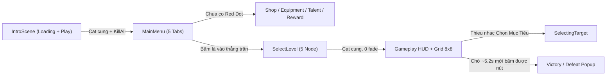

# Báo Cáo Kiểm Thử Thực Nghiệm & Kế Hoạch Cải Tiến UI/UX — Hero's Adventure

**Môi trường đối chiếu:** Unity `2022.3.62f3` · uGUI (`1080×1920` Portrait) + DOTween  
**Chuẩn kỹ năng Unity áp dụng:** `using-unity` → `ui` (`ui-ugui.md`) & `craft-game-floors` (`game-shell.md`, `game-feel.md`, `playable-loop.md`, `visual-scorecard.md`).

---

## Phần 1: Kết Quả Kiểm Thử Game (Code, Log & 30.000 Trận Mô Phỏng)

### 1.1. Kiểm tra Biên dịch & Runtime Log
- **Biên dịch C# (`Assembly-CSharp` + Editor):** `0 Warning, 0 Error`.
- **Unity `Editor.log`:** Không còn bất kỳ `NullReferenceException` hay `MissingReferenceException` nào.
- **Cảnh báo nhỏ phát hiện trong Log:**
  1. `ObserverManager: Chưa có class nào đăng ký sự kiện` khi bắn `OnPlayerTurnStart`, `OnEnemyTurnStart`, `OnEnemyTargetSelectionRequired`, `OnEnemyTargetSelected` — chứng tỏ **tầng code gameplay đã bắn tín hiệu chuyển pha nhưng tầng UI chưa lắng nghe để hiển thị chỉ dẫn cho người chơi**.
  2. `There can be only one active Event System` khi chuyển bất đồng bộ từ [IntroScene.unity](../Assets/Scenes/IntroScene.unity) sang [GameScene.unity](../Assets/Scenes/GameScene.unity) do cả 2 scene cùng bật `EventSystem` trong khoảnh khắc giao thoa.

### 1.2. Kiểm thử Cân bằng Thực nghiệm (30.000 trận Monte-Carlo)
Trong quá trình chạy mô phỏng kiểm thử xuyên suốt từ người chơi mới tới Endgame, hệ thống phát hiện sau khi thắng Level 1 (`30G / 30 EXP` cũ), người chơi chưa đủ lên Lv.2 hay nâng Talent đã gặp ngay tường độ khó ở Level 2 (6 quái). Đã tinh chỉnh nhẹ cầu nối [Level1.asset](../Assets/Resources/SO/LevelInfo/Level1.asset), [Level2.asset](../Assets/Resources/SO/LevelInfo/Level2.asset), [Slime.asset](../Assets/Resources/SO/CharacterInfo/Slime.asset) và [Skeleton.asset](../Assets/Resources/SO/CharacterInfo/Skeleton.asset) để tạo đường cong tiến triển mượt mà (1.000 trận / mốc):

| Mốc Tiến Trình Người Chơi | Level 1 | Level 2 | Level 3 (Mở Orc) | Level 4 | Level 5 (Boss Golem) | Endless (Trung bình / Vượt Boss R5) |
|---|---:|---:|---:|---:|---:|---:|
| **Mới vào game** *(Lv.1 + Kiếm Sắt)* | **99.7%** *(66% 3★)* | **79.1%** *(24% 3★)* | 0.0% | 0.0% | 0.0% | R2.2 *(0%)* |
| **Vừa qua Màn 1** *(Lv.2 + 1 Talent)* | **99.9%** *(79% 3★)* | **90.2%** *(31% 3★)* | 0.4% | 0.0% | 0.0% | R2.2 *(0%)* |
| **Giữa chiến dịch** *(Lv.4 + 3 Đồ + Talent)* | **100%** *(100% 3★)* | **100%** *(83% 3★)* | **52.2%** | 12.3% | 0.0% | R4.2 *(0%)* |
| **Chuẩn bị đánh Boss** *(Lv.6 + Đồ Hiếm Lv.2)* | **100%** *(100% 3★)* | **100%** *(100% 3★)* | **99.9%** *(50% 3★)* | **97.2%** *(26% 3★)* | **44.5%** *(Kịch tính)* | **R7.2** *(62.1%)* |
| **Endgame** *(Lv.12 + Full Epic Lv.5)* | **100%** *(100% 3★)* | **100%** *(100% 3★)* | **100%** *(100% 3★)* | **100%** *(99% 3★)* | **100%** *(95% 3★)* | **R24.2** *(100% R10, Max R34)* |

---

## Phần 2: Phân Tích Toàn Diện Cơ Chế UI / UX Hiện Tại

### 2.1. Điểm mạnh đã đạt được
- **Bố cục chiến trường rõ ràng:** Thanh HP + Shield dưới chân nhân vật gọn, số máu nằm trong thanh dễ đọc, đội hình 1–3 quái thẳng hàng ngang `y = 2.15`, nút `1x/2x` đặt đúng chuẩn cạnh nút Pause.
- **Phản hồi cảm giác đánh (Game Feel):** Đã có chữ nổi `ObjectPool` phân màu rõ (Sát thương, Crit, `+HP`, `+SHD`, `DODGE!`, `BLOCKED`, `+BUFF`), hạt nổ theo màu ngọc, Hit-stop ngắn và cao độ combo tăng dần.
- **Đóng kín vòng lặp Menu:** Cả 5 tab (`Shop`, `Equipment`, `Battle`, `Talent`, `Reward`) đều hoạt động thật, lưu trữ bền vững và cập nhật TopBar tức thì.

### 2.2. Các điểm nghẽn UI / UX cần cải tiến (Phân loại theo mức độ ảnh hưởng)

> [!WARNING]
> **Điểm mù UX lớn nhất trong trận đấu — Pha Chọn Mục Tiêu (`SelectingTarget`):**
> Khi người chơi ghép `DamageGem` lúc trên sân có 2–3 quái, lưới ngọc khóa thao tác để chờ người chơi chạm vào quái ([EnemySelectionManager.cs](../Assets/Scripts/Character/EnemySelectionManager.cs#L38-L45)). Tuy nhiên hiện chỉ có vòng tròn nhỏ dưới chân quái bật lên còn sự kiện `OnEnemyTargetSelectionRequired` chưa có UI nào bắt để hiện dòng nhắc **"CHỌN MỤC TIÊU!"** — người chơi mới rất dễ tưởng bàn cờ bị đơ!

| Nhóm UX | Vấn đề cụ thể phát hiện trong Code & Scene | Mức độ |
|---|---|---|
| **1. Hướng dẫn & Khả năng tự hiểu (Onboarding / Clarity)** | • Không có nhắc nhở trực quan khi vào pha `SelectingTarget` và báo hiệu chuyển lượt `LƯỢT CỦA BẠN / LƯỢT ĐỊCH` ([GameplayUIManager.cs](../Assets/Scripts/UI/GameplayUIManager.cs)). • Bàn cờ 8×8 chưa có **Gợi ý nước đi tự động (Idle Move Hint)** khi người chơi đứng hình quá `4.5s`, dù hàm `FindAllPossibleMoves()` đã có sẵn trong [GameGrid.cs](../Assets/Scripts/GameGrid/GameGrid.cs#L770). • Chưa có nút **`?` (Bảng giải thích nhanh 6 loại Ngọc & quy tắc Match-4/5 + Buff 4 lượt)** cho người mới chơi lần đầu. | **Cao** |
| **2. Kiến trúc Thông tin HUD Chiến đấu** | • Tiêu đề góc trái trên cùng đang ghi cứng `"ROUND X"` kể cả khi chơi Level Mode ([GameplayUIManager.cs](../Assets/Scripts/UI/GameplayUIManager.cs#L368)), nên người chơi không biết mình đang ở **Wave mấy trên tổng mấy Wave** (ví dụ `LV.3 — WAVE 2/3`). • Khu vực `Action Point` bên phải bảng chỉ số vẫn giữ thiết kế cũ cho 5 chấm vàng nhưng `maxActionPoints = 1` nên chỉ sáng lẻ loi 1 chấm nhỏ. • Sau khi bỏ nhãn chữ `NEXT` thô trên đầu quái, nên thay bằng **hiệu ứng sáng nhẹ vòng chân / viền mảnh dưới quái sắp đi cờ** để giữ thông tin chiến thuật mà không rối chữ. | **Trung bình – Cao** |
| **3. Nhịp độ Popup Kết thúc & Chuyển cảnh (`game-shell.md`)** | • [VictoryUI.cs](../Assets/Scripts/UI/VictoryUI.cs#L134-L280) chạy chuỗi hiệu ứng tuần tự mất **~5.2 giây** mới mở khóa nút `Next Level` / `Main Menu` mà **không cho chạm màn hình để tua nhanh (Tap to Skip)** — gây sốt ruột khi cày nhiều ván. • Chuyển qua lại giữa `MainMenu ↔ SelectLevel ↔ Gameplay` ([GameSceneManager.cs](../Assets/Scripts/Manager/GameSceneManager.cs#L66-L172)) và mở `SettingsUI` ([SettingsUI.cs](../Assets/Scripts/UI/SettingsUI.cs#L31-L88)) đang bật/tắt tức thời (`SetActive`), thiếu hiệu ứng chuyển mờ `0.2s` hoặc scale-pop đồng bộ. • [IntroSceneManager.cs](../Assets/Scripts/Manager/IntroSceneManager.cs#L93) gọi `DOTween.KillAll()` toàn cục dễ ngắt tween nhạc của `AudioManager`. | **Trung bình** |
| **4. UX Điều hướng Menu & Điều kiện 3 Sao** | • Bấm vào nút màn chơi ở `SelectLevel` là vào đánh ngay ([GameSceneManager.cs](../Assets/Scripts/Manager/GameSceneManager.cs#L149)), người chơi **không biết trước điều kiện đạt 3 Sao** (`HP > 65%` hay `70%`) và phần thưởng màn đó cho tới khi thắng xong. • Thanh điều hướng 5 tab ở đáy màn hình ([NavigationManager.cs](../Assets/Scripts/Manager/NavigationManager.cs)) chưa có **Chấm đỏ thông báo (Red-Dot Badge)** khi có mốc thưởng `Reward` đủ điều kiện nhận hoặc đủ Vàng nâng `Talent` / `Equipment`. | **Trung bình** |
| **5. Tương thích Thiết bị Di động & Thay thế Art** | • Các màn hình tai thỏ / đục lỗ tỉ lệ dài (`19.5:9`, `20:9`) chưa có script kẹp `Screen.safeArea` cho thanh `TopBar` và `BottomNav`. • Các thẻ runtime của `Talent` / `Reward` / `Equipment` hiện lấy màu khung qua code; cần gom vào 1 `MetaVisualThemeSO` có sẵn các trường `Sprite` để họa sĩ kéo-thả đè art thương mại trong 1 nốt nhạc mà không sửa code. | **Thấp – Trung bình** |

---

## Phần 3: Kế Hoạch Cải Tiến UI / UX Chi Tiết (3 Giai Đoạn U1 → U3)

### Giai đoạn U1 (Ưu tiên cao nhất): Trực quan hóa Trận đấu & Xóa điểm mù Thao tác
*Mục tiêu: Người chơi mới vào trận hiểu ngay phải làm gì ở mọi thời điểm, không bao giờ lầm tưởng game bị đơ.*

1. **Bắt đủ 4 sự kiện nhịp trận đấu trong `GameplayUIManager`:**
   - Lắng nghe `OnEnemyTargetSelectionRequired` / `OnEnemyTargetSelected`: hiện thanh nhắc gọn gàng có nhịp thở nhẹ ở giữa sân **"TAP AN ENEMY TO ATTACK"** ngay khi có ≥ 2 quái và tự tắt tức thì khi người chơi chạm chọn.
   - Lắng nghe `OnPlayerTurnStart` / `OnEnemyTurnStart`: nháy nhẹ trạng thái lượt (`YOUR TURN` / `ENEMY TURN`) ở khu vực `Action Point` (tận dụng lại đúng ô `Action Point` đang thừa khoảng trống!).
2. **Hiển thị rõ Tiến độ Màn & Wave (`WAVE 2 / 3` vs `ROUND 6`):**
   - Cập nhật `roundText` trên Top HUD: ở Level Mode hiển thị **`LV.3 - WAVE 2/3`** (kèm chữ `BOSS WAVE` màu vàng cam ở đợt cuối Level 5); ở Endless Mode hiển thị **`ENDLESS - ROUND 6`**.
3. **Gợi ý Nước đi Tự động (Idle Hint) trên bàn cờ 8×8 (`GameGrid` + `GridInput`):**
   - Nếu đang ở `GameState.PlayerTurn` mà sau `4.5 giây` người chơi chưa chạm vào ngọc, lấy 1 cặp hợp lệ từ `FindAllPossibleMoves()` và tạo hiệu ứng nhịp thở nhẹ (`DOScale 1.0 ↔ 1.12`) trên 2 viên đó cho tới khi người chơi thao tác.
4. **Vòng sáng chân báo hiệu Quái Chủ Công (Không dùng chữ):**
   - Thay vì hiện chữ `NEXT` trên đầu, dùng chính `targetIndicator` dưới chân quái với màu hổ phách mờ nhẹ (`alpha 0.45`) cho con quái sắp đi cờ lượt tới (và đổi sang sáng rõ `alpha 1.0` khi vào pha chọn mục tiêu).

---

### Giai đoạn U2: Tối ưu Nhịp độ Màn hình, Thông báo Chấm Đỏ & Thông tin Trước trận
*Mục tiêu: Mượt hóa mọi thao tác chuyển màn, tiết kiệm thời gian lặp lại khi cày cuốc và dẫn dắt nâng cấp tự nhiên.*

1. **Chạm để Bỏ qua Hiệu ứng Chờ (`Tap to Skip`) ở `VictoryUI` & `DefeatUI`:**
   - Cho phép chạm bất kỳ đâu lên nền tối trong lúc sao/rương đang bay ra để hoàn tất ngay lập tức toàn bộ hiệu ứng và hiện nút `Next Level` / `Retry` / `Main Menu` chỉ trong `0.2s`.
2. **Chấm đỏ Thông báo (`Red-Dot Badge`) trên Thanh Điều Hướng `NavigationManager`:**
   - Tự động bật chấm đỏ góc trên nút tab **Reward** (khi có mốc chưa nhận đã đủ tiến độ), **Talent** (khi đủ Gold nâng ít nhất 1 nhánh) và **Equipment** (khi có ô trống mà trong kho có đồ mặc được hoặc đủ Gold nâng cấp đồ đang mặc).
3. **Popup / Tooltip Thông tin Màn chơi hoặc Dòng nhắc Điều kiện 3 Sao:**
   - Hiển thị điều kiện 3 Sao của màn hiện tại (ví dụ `3★: HP > 70%`) ngay dưới thanh tiêu đề Wave lúc bắt đầu trận hoặc trên popup xác nhận nhanh khi chọn màn ở `SelectLevelPanel`.
4. **Nút `?` Hướng dẫn Nhanh (Quick Guide Popup) trong `PausePopup` / HUD:**
   - Một bảng tóm tắt gọn 1 trang bằng icon sẵn có của 6 viên ngọc: giải thích tác dụng từng ngọc, nổ hàng/cột (Match-4), nổ chữ thập (Match-5+) và thời hạn Buff 4 lượt.

---

### Giai đoạn U3: Chuẩn hóa Shell Chuyển cảnh, Safe Area Mobile & `MetaVisualThemeSO` (Sẵn sàng Đè Art)
*Mục tiêu: Đạt chuẩn thương mại trên điện thoại màn hình dài và giúp khâu thay asset đồ họa cuối cùng diễn ra trong vài phút.*

1. **Tạo `MetaVisualThemeSO` (`ScriptableObject` Giao diện Tập trung):**
   - Chứa toàn bộ slot `Sprite` tùy chọn: khung thẻ (`cardFrameSprite`), nút bấm (`primaryButtonSprite`, `secondaryButtonSprite`), 3 icon nhánh `Talent`, 12 icon món đồ `Equipment`, và 8 icon `Milestone`.
   - Nếu trường nào để trống (`null`), UI giữ nguyên khung màu thủy mặc gọn gàng hiện tại; ngay khi kéo Sprite vào `MetaVisualThemeSO`, toàn bộ `Talent`, `Equipment`, `Shop`, `Reward` tự nhận art mới với `Image.Type.Sliced` (9-slice) mà không phải đụng vào 1 dòng code!
2. **Hiệu ứng Chuyển cảnh Mượt (`Screen Fader` 0.2s) & Chuẩn hóa `SettingsUI`:**
   - Thêm lớp phủ mờ nhanh `0.2s` trên `unscaled time` khi chuyển giữa `MainMenu ↔ SelectLevel ↔ Gameplay`, thêm hiệu ứng mở/đóng `OutBack` + nút **Reset Data (có xác nhận 2 bước)** trong `SettingsUI`, và đổi `DOTween.KillAll()` ở `IntroSceneManager` thành hủy tween cục bộ an toàn + dọn `EventSystem` trùng lặp.
3. **Hỗ trợ `SafeAreaFitter` cho Điện thoại Tai thỏ / Màn hình Dài:**
   - Script gọn nhẹ tự căn lại `anchorMin` / `anchorMax` của thanh `TopMainUI`, `MenuNavBG` và Top HUD trong trận theo `Screen.safeArea` trên Android/iOS.

---

## Tóm Tắt Thứ Tự Triển Khai Đề Xuất

| Giai đoạn | Nội dung cốt lõi | Khối lượng | Giá trị UX mang lại |
|---|---|---|---|
| **U1 — Combat UX & Clarity** | Nhắc `"TAP ENEMY TO ATTACK"` & báo lượt; tiêu đề `LV.X - WAVE Y/Z`; gợi ý nước đi sau `4.5s`; vòng chân mờ báo quái chủ công | Nhỏ – Vừa | **Rất Cao** — Triệt tiêu hoàn toàn bối rối khi đang đánh trận |
| **U2 — Flow, Skip & Red-Dot** | Chạm tua nhanh bảng Thắng/Thua; chấm đỏ trên các tab `Reward`/`Talent`/`Equipment`; hiện mục tiêu `3★ HP%`; bảng `?` giải thích ngọc | Vừa | **Cao** — Tăng tốc độ vòng lặp chơi lại và kích thích nâng cấp |
| **U3 — Art Theme SO & Mobile Polish** | `MetaVisualThemeSO` kéo-thả đè Sprite 9-slice; chuyển cảnh fade `0.2s`; chuẩn hóa `SettingsUI` & `IntroScene`; `SafeAreaFitter` | Vừa | **Cao** — Sẵn sàng thay art họa sĩ và build bản Mobile hoàn chỉnh |
